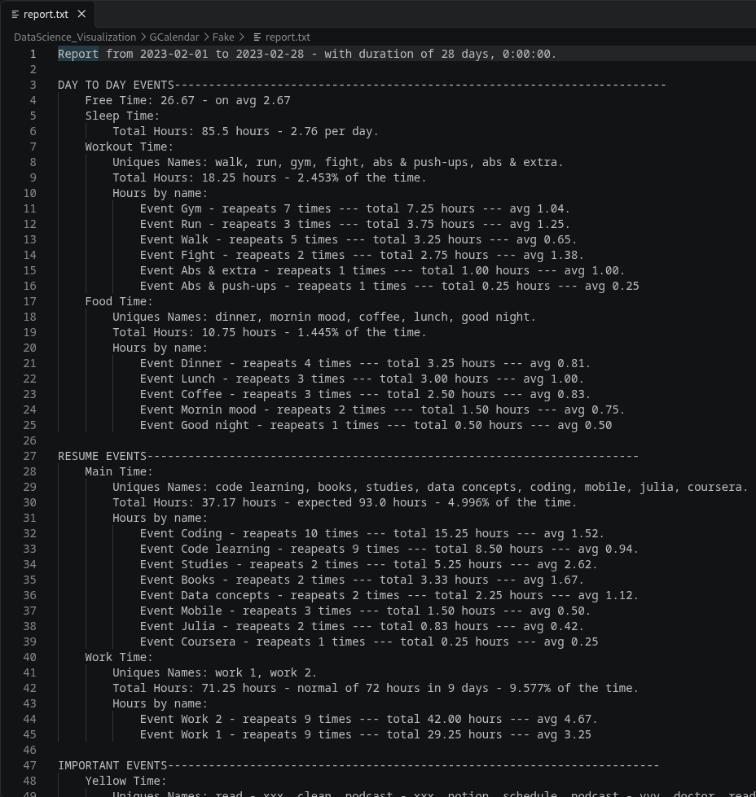
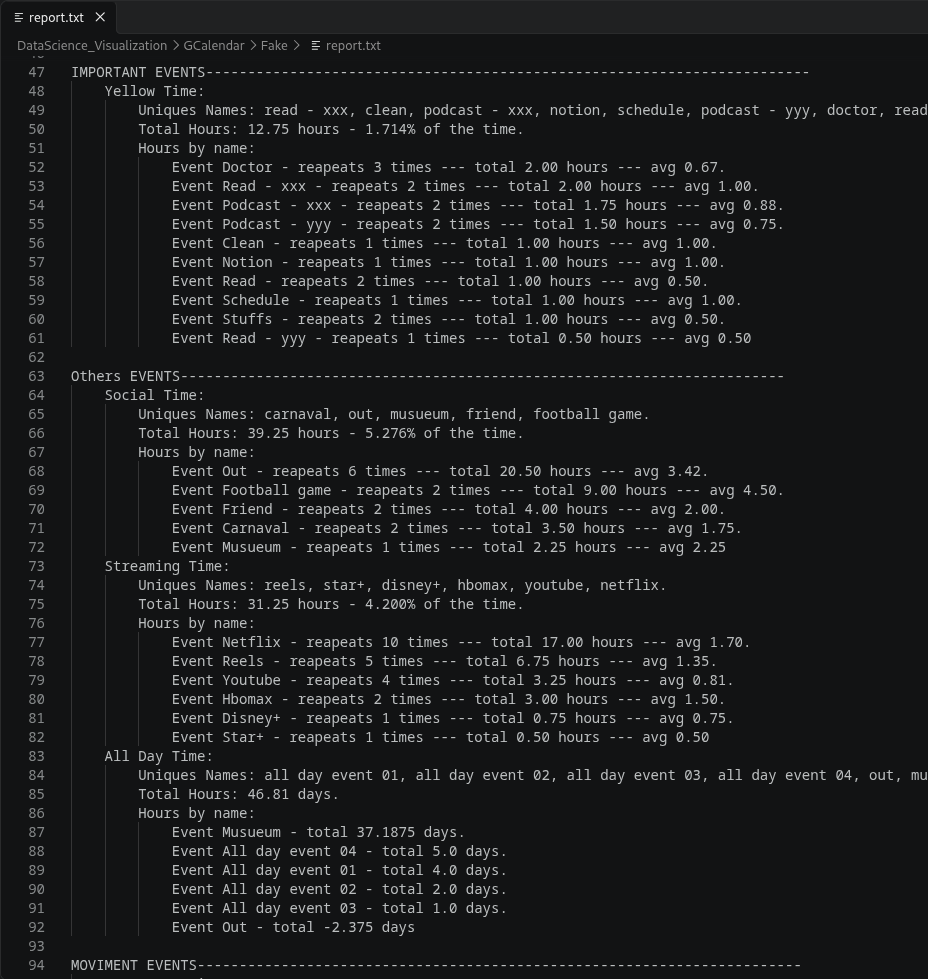
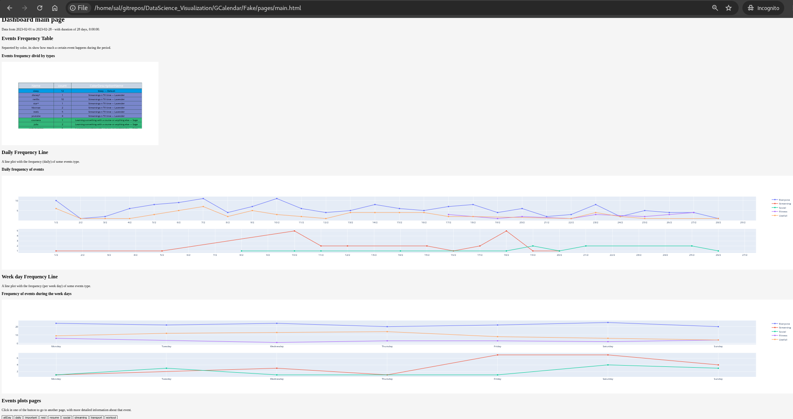
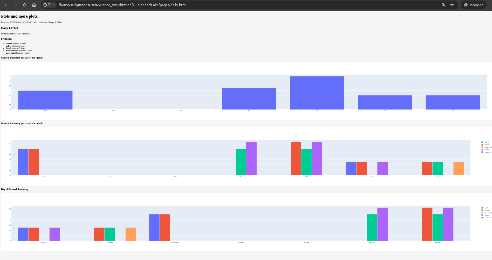
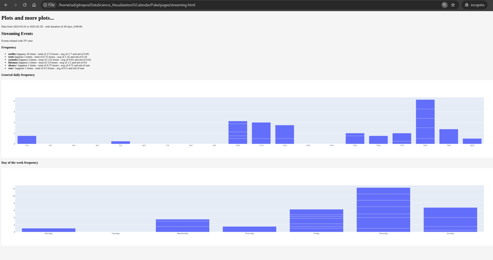
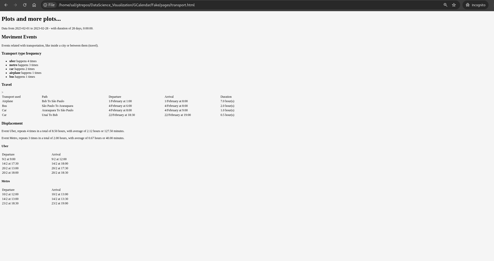

> A report and a web dashboard of your life, or at least of as much of it as you are willing to track in Google Calendar.

See the [GitHub repo](https://github.com/salomaoalves/DataScience_Visualization/tree/main/GCalendar) for more technical details (it has a README).

This project turns the events from a **Google Calendar** account into a **report** and a **web dashboard**. All the code was developed in Python, the charts are built with Plotly, and the data comes from the Google Calendar API.

The calendar events need to follow a color pattern. I built the project for my personal account, which ended up with two patterns:

- **Events before 2022** are covered by a one-off report. See `Report|2018-21` and `report_specifYear.py`.
- **Events from 2022 onwards** are handled by all the other files and folders.

To use the project with your own Google Calendar, you need everything except `Report|2018-21` and `report_specifYear.py` (and one other file). **Important:** check the color patterns of your events first, because the results depend on them.

## Report
To create a report, call the `get_report()` function from `report.py`. It takes the data (from `modConstants`) and builds the report step by step: each code block computes a statistic or metric (an aggregation) and appends it to the report structure.

The report can be saved as a `.txt` or an HTML file. With HTML, you can also use the email function in the same file to send the report by email.

<figure style="margin: 0;">
  

    
    
  

  <figcaption style="text-align: center; font-size: 0.9em; margin-top: 6px;">Google Calendar Report - fake data</figcaption>
</figure>

## Web Dashboard
To create the dashboard, run `dashboard.py`. It takes the data (from `modConstants`), prepares it, creates the general charts and builds the web pages: a main page plus one page for each event type. The functions it uses live in the `Visu` folder.

The dashboard is built as plain HTML files, so it can be sent by email or uploaded to a server. Each chart (bar, table, line) is built with Plotly in `Visu/build.py` and exported to an HTML file with Plotly Offline at the end of its function.

`Visu/create_html.py` has the functions that build the HTML of the dashboard pages, placing each exported chart in the right place and format. The other files in `Visu` create the charts used on each page.

<figure style="margin: 0;">
  

    
    
    
    
  

  <figcaption style="text-align: center; font-size: 0.9em; margin-top: 6px;">Google Calendar Web Dashboard - fake data</figcaption>
</figure>

*Images are AI-generated*